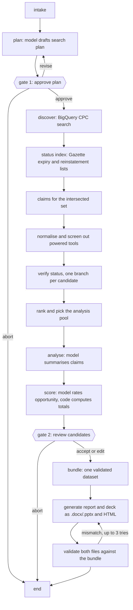

# patentic

patentic finds US utility patents that appear to have expired because the owner stopped paying maintenance fees. It checks the public status evidence for each one, including any later reinstatement, scores the survivors as product opportunities, and writes a Word report and a PowerPoint deck from the same validated data.

> Research screening only. Not a legal opinion or freedom-to-operate determination.

Every status claim in the output carries a date and a source. An expired patent can be reinstated, so a status is only as current as the last Gazette issue the run read.

## Quick start

A 70-second recording of these steps is in [docs/demo/demo.mp4](docs/demo/demo.mp4). Re-record it with `vhs docs/demo/demo.tape`.

You need Python 3.12 and [uv](https://docs.astral.sh/uv/).

```bash
uv sync
cp .env.example .env
make demo
```

`make demo` runs six synthetic patents through the full pipeline with no network and no keys. It stops twice to ask you questions (see [The two gates](#the-two-gates)). The files land in `outputs/runs/<run id>/`.

To rerun the committed real result offline, also with no keys:

```bash
uv run patentic run --replay
```

For a live run you need a Google Cloud project with BigQuery enabled (the free sandbox is enough). Put its id in `.env` as `GOOGLE_CLOUD_PROJECT`, log in with `gcloud auth application-default login`, then:

```bash
make run
```

The first live run scans about 44 GB of BigQuery data, well inside the 1 TB monthly free tier. Queries are cached by their exact text: a rerun on the same day scans nothing, a run on a later day repeats discovery (2.3 GB), and a run after a new Gazette issue changes the candidate set repeats the claims query (about 39 GB). That allows about 20 fresh weekly runs a month on the free tier. Language model calls go through `llm/` (the `freellm` package), which routes to free providers and works with no keys at all, slowly. Keys for faster free providers go in `llm/.env`; `cd llm && uv run freellm keys --steps` lists where to get them.

## The two gates

A run pauses twice and waits for you.

1. **Plan approval.** The model drafts a search plan from the request: CPC codes, search terms, exclusions and sources. Answer `approve`, `revise` (you type what should change, up to three times) or `abort`.
2. **Candidate review.** After scoring, you see the candidates with status, confidence and score. Answer `accept`, `edit` (drop candidates, pick a shortlist of at most two, add a note to one) or `abort`.

To run without prompts, pass a file of answers. `fixtures/decisions/approve-all.yaml` approves the plan and accepts the review:

```bash
uv run patentic run --decisions fixtures/decisions/approve-all.yaml
```

If a run stops at a gate or is killed, continue it with `uv run patentic resume <run id>`. The state is checkpointed in SQLite after every step.

## Commands and flags

| Command | What it does |
|---|---|
| `patentic run` | Live run on `fixtures/requests/demo-cleaning-tools.yaml`, or on `--request-file` |
| `patentic demo` | The six synthetic fixtures, offline |
| `patentic resume <run id>` | Continue a stopped run |
| `patentic cost <run id>` | Print BigQuery bytes, model calls, tokens and cost for a run |
| `patentic schemas` | Write the JSON Schemas in `schemas/` |

Flags for `run`:

| Flag | Effect |
|---|---|
| `--decisions FILE` | Answer both gates from a YAML file instead of prompting |
| `--replay` | Rerun the committed real run from `fixtures/replay/`, offline, with its recorded model answers |
| `--simulate-outage og\|bigquery\|ops` | Make one source fail, to show how the run degrades |
| `--offline` | Use cached data only |
| `--no-llm` | Skip the model; every model step uses its template |
| `--og-weeks N` | Number of Gazette weeks to scan (default 104) |
| `--render` | Also render the report to PDF with LibreOffice and check the page count |
| `--thread-id ID` | Choose the run id |

## What the demo shows

The synthetic fixtures (US 9,999,901 to 9,999,906, all made up and labelled SYNTHETIC FIXTURE in the output) cover six status cases: a clean expiry for nonpayment, an expiry followed by a reinstatement, a patent still inside its grace period, a patent past its 20-year term, two sources that disagree, and an expired patent with a related continuation that is still active.

`--simulate-outage og` shows a source outage. The Gazette requests fail, the run records the outage in the log and in the report, reports no candidates because no status could be checked, and still writes and validates both files. `--simulate-outage bigquery` does the same for discovery.

The real report also carries one real conflicting case as a worked example. The Gazette listed US 8,646,606 as reinstated on 2026-10-07, while Google Patents still showed it as expired when we checked. patentic follows the later official notice and keeps the other observation visible.

## How it works



It is a fixed LangGraph workflow, not an autonomous agent. The model is used in a few bounded places (plan, claim summaries, opportunity rationale, report prose), always with a schema, a check on its answer and a template to fall back on. Status labels, confidence and scores are computed by code from the evidence. Details are in [docs/architecture.md](docs/architecture.md).

## Data sources

| Source | Used for | Credential | Limits |
|---|---|---|---|
| USPTO Official Gazette notices | Expiry for nonpayment and reinstatement lists, weekly since 2008 | None | One request per second, cached forever |
| BigQuery `patents-public-data.patentsview` | Discovery by CPC, claims, citations, continuity, terminal disclaimers | Google Cloud project | 1 TB scanned per month free; 50 GB cap per query; grants to 2021-09-28 |
| EPO Open Patent Services | Second status source (INPADOC lapse and reinstatement events) | Free EPO registration (`EPO_OPS_KEY`, `EPO_OPS_SECRET`) | 4 GB a week free; one request per verified candidate, cached 24 hours |
| USPTO ODP maintenance fee events | Full fee history | ODP key, which needs ID.me verification | Parser built and tested on sample lines; not used live |

The full table, with lag, terms and query costs, is in [docs/data-sources.md](docs/data-sources.md).

## Outputs

Each run writes to `outputs/runs/<run id>/`:

- `report.docx`: the ten sections the brief lists, with status timelines, claim summaries, related patents, scores and references.
- `deck.pptx`: nine slides with the same candidates, statuses, scores and recommendations.
- `report.html` and `deck.html`: the same report and deck as self-contained web pages. The deck pages step with the arrow keys; the report has a clickable contents list. The Word and PowerPoint styling was designed in these pages first and ported to match.
- `bundle.json`: the dataset all four files are rendered from.
- `validation.json`: the checks that compare every file with the bundle and the Office files with the OOXML schemas.
- `events.jsonl`, `cost.json`, `run.json`, `checkpoints.sqlite`: the redacted event log, cost record, run settings and resume state.

A real run is committed in `outputs/samples/`, with its log in `docs/sample-logs/`. It scanned 2,404 cleaning-tool patents, found 299 listed as expired in the last 104 weeks of Gazette notices, and shortlisted US 8,800,092 (a flat mop that releases its cloth with a trigger) and US 8,826,487 (a mop set with a built-in device for wringing the mop). Every reported status is `expired_nonpayment` at confidence `very_high`, because the Gazette notice and the EPO legal events agree and the reinstatement scan is complete.

## Tests and CI

```bash
make check
```

This runs ruff, `mypy --strict` and the test suite (about 275 tests, all offline; sockets are blocked). GitHub Actions runs the same on every push, plus a non-blocking job that renders the report with LibreOffice. `tests/e2e/test_replay.py` reruns the real sample from `fixtures/replay/` and checks it matches.

## Limitations, time and cost

The known limits are in [docs/limitations.md](docs/limitations.md). The main ones: PatentsView data ends with grants of 2021-09-28, the Gazette scan covers 104 weeks, patent term adjustment is not known, and free models give slightly different scores from run to run.

Hours per task, BigQuery bytes and model cost are in [docs/time-and-cost.md](docs/time-and-cost.md). The sample run cost $0.

## AI assistance

I built this with Claude Code. It helped with the research, the design, the implementation and these docs. I reviewed, tested and ran everything, and I can explain and change any part of it.

## Licence

No open-source licence has been chosen; all rights reserved. `tools/ooxml/` is Anthropic's OOXML validator under Apache-2.0 (see its `LICENSE.txt`).
