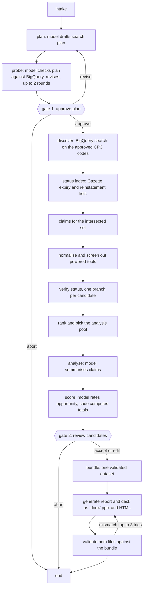

# patentic

patentic finds US utility patents that appear to have expired because the owner stopped paying maintenance fees. It checks the public status evidence for each one, including any later reinstatement, scores the survivors as product opportunities, and writes a Word report and a PowerPoint deck from the same validated data.

> Research screening only. Not a legal opinion or freedom-to-operate determination.

Every status claim in the output carries a date and a source. An expired patent can be reinstated, so a status is only as current as the last Gazette issue the run read.

## Quick start

A 70-second recording of these steps is in [docs/demo/demo.mp4](docs/demo/demo.mp4). Re-record it with `vhs docs/demo/demo.tape`.

You need Python 3.12 and [uv](https://docs.astral.sh/uv/).

The full guide, including how to write a request file and answer the gates, is [docs/usage.md](docs/usage.md). A step-by-step demo script is in [docs/demo/demo-plan.md](docs/demo/demo-plan.md).

```bash
uv sync
cp .env.example .env
make demo
```

`make demo` runs six synthetic patents through the full pipeline with no network and no keys. It stops twice to ask you questions (see [The two gates](#the-two-gates)). The files land in `outputs/runs/<run id>/`.

To rerun the committed real result offline, also with no keys:

```bash
uv run patentic run --replay
```

For a live run you need a Google Cloud project with BigQuery enabled (the free sandbox is enough). Put its id in `.env` as `GOOGLE_CLOUD_PROJECT`, log in with `gcloud auth application-default login`, then:

```bash
make run
```

The first live run scans about 44 GB of BigQuery data, well inside the 1 TB monthly free tier. After that, runs reuse a local cache in `.cache/`: discovery is cached for the calendar year (the query asks for whole years and the exact window is filtered locally), and claims, citations and continuity are fetched once for every discovered patent and kept per patent, so a new Gazette issue adds no BigQuery cost. Gazette pages are kept forever (past issues never change), EPO answers for a week, and successful model answers by prompt, so a rerun on the same data skips the model calls. Delete `.cache/` to start fresh. Language model calls go through `llm/` (the `freellm` package), which routes to free providers and works with no keys at all, slowly. Keys for faster free providers go in `llm/.env`; `cd llm && uv run freellm keys --steps` lists where to get them.

## The two gates

A run pauses twice and waits for you.

1. **Plan approval.** The model drafts a search plan from the request: CPC codes, search terms, exclusions and sources. On a live run it then checks the plan against BigQuery for up to two rounds: it sees how many patents each code finds, sample titles, and groups that often appear next to its hits, and revises the plan. The gate shows what the search will add to the default CPC set and which codes were ignored and why. Answer `approve`, `revise` (you type what should change, up to three times) or `abort`. The approved CPC codes are what discovery searches.
2. **Candidate review.** After scoring, you see the candidates with status, confidence and score. Answer `accept`, `edit` (drop candidates, pick a shortlist of at most two, add a note to one) or `abort`.

To run without prompts, pass a file of answers. `fixtures/decisions/approve-all.yaml` approves the plan and accepts the review:

```bash
uv run patentic run --decisions fixtures/decisions/approve-all.yaml
```

If a run stops at a gate or is killed, continue it with `uv run patentic resume <run id>`. The state is checkpointed in SQLite after every step.

## Commands and flags

| Command | What it does |
|---|---|
| `patentic run` | Live run on `fixtures/requests/demo-cleaning-tools.yaml`, or on `--request-file` |
| `patentic demo` | The six synthetic fixtures, offline |
| `patentic resume <run id>` | Continue a stopped run |
| `patentic cost <run id>` | Print BigQuery bytes, model calls, tokens and cost for a run |
| `patentic schemas` | Write the JSON Schemas in `schemas/` |

Flags for `run`:

| Flag | Effect |
|---|---|
| `--decisions FILE` | Answer both gates from a YAML file instead of prompting |
| `--replay` | Rerun the committed real run from `fixtures/replay/`, offline, with its recorded model answers |
| `--simulate-outage og\|bigquery\|ops` | Make one source fail, to show how the run degrades |
| `--offline` | Use cached data only |
| `--no-llm` | Skip the model; every model step uses its template |
| `--og-weeks N` | Number of Gazette weeks to scan (default 104) |
| `--render` | Also render the report to PDF with LibreOffice and check the page count |
| `--thread-id ID` | Choose the run id |

## What the demo shows

The synthetic fixtures (US 9,999,901 to 9,999,906, all made up and labelled SYNTHETIC FIXTURE in the output) cover six status cases: a clean expiry for nonpayment, an expiry followed by a reinstatement, a patent still inside its grace period, a patent past its 20-year term, two sources that disagree, and an expired patent with a related continuation that is still active.

`--simulate-outage og` shows a source outage. The Gazette requests fail, the run records the outage in the log and in the report, reports no candidates because no status could be checked, and still writes and validates both files. `--simulate-outage bigquery` does the same for discovery.

The real report also carries one real conflicting case as a worked example. The Gazette listed US 8,646,606 as reinstated on 2026-10-07, while Google Patents still showed it as expired when we checked. patentic follows the later official notice and keeps the other observation visible.

## How it works



It is a fixed LangGraph workflow, not an autonomous agent. The model is used in a few bounded places (plan and its refinement against the data, claim summaries, opportunity rationale, report prose), always with a schema, a check on its answer and a template to fall back on. Status labels, confidence and scores are computed by code from the evidence. Details are in [docs/architecture.md](docs/architecture.md).

## Code structure

The entry point is `patentic` (`pyproject.toml` maps it to `patentic.cli:app`, and `python -m patentic` does the same). `cli.py` reads the request, builds the dependencies in `wiring.py`, and hands both to `runner.py`, which runs the LangGraph workflow from `graph/build.py`.

```text
repo/
├── src/patentic/        the package
├── tests/               offline tests, mirrors src/
├── fixtures/            synthetic patents, scripted gate answers, the committed replay run
├── schemas/             JSON Schemas exported from the data models
├── templates/           styled blank .docx and .pptx the renderers fill in
├── scripts/             one-off tools (build the replay, regenerate templates)
├── tools/ooxml/         OOXML schema validator used by the output checks
├── docs/                architecture, data sources, limitations, ADRs, demo material
├── outputs/             run folders and the committed sample run
├── llm/                 the freellm package: routes model calls to free providers
└── Makefile             shortcuts for every workflow (`make help`)
```

### `src/patentic/`

| Path | What it does |
|---|---|
| `cli.py` | Typer commands: `run`, `demo`, `resume`, `cost`, `schemas`. Parses flags and starts a run. |
| `wiring.py` | Builds the `Deps` bundle (data sources, model caller, settings) for live, demo, offline and replay modes. This is where `--simulate-outage` swaps in a failing source. |
| `runner.py` | Runs the compiled graph on a SQLite checkpoint, pauses at the two gates, resumes, and writes the run folder. |
| `runlog.py` | Writes `events.jsonl` and redacts keys and tokens from it. |
| `replay.py` | Packs a finished run into `fixtures/replay/` and unpacks it for `run --replay`. Answers model calls from the recording. |
| `schemas_export.py` | Writes the JSON Schemas for `patentic schemas`. |

**`graph/`** is the workflow. `build.py` wires the nodes into the graph drawn above. `state.py` defines the shared state and `reducers.py` the rules for merging updates from parallel branches. `deps.py` is the dependency container, and `progress.py` emits the progress lines.

| Node file in `graph/nodes/` | Step |
|---|---|
| `plan.py` | Intake, the model's search plan, probe-and-revise against BigQuery, and gate 1 (`approve`) |
| `discover.py` | BigQuery discovery on the approved CPC codes, the Gazette status index, and the claims fetch |
| `normalise.py` | Cleans records and screens out powered tools |
| `verify.py` | One branch per candidate: collects status events and grades them |
| `rank.py` | Picks the pool that gets model analysis |
| `analyse.py` | Model summaries of the independent claims |
| `score.py` | Model rates opportunity, code computes totals and recommendations |
| `review.py` | Gate 2, where the user accepts or edits the shortlist |
| `bundle.py` | Assembles the single `ReportBundle`, including timelines, related patents and prose |
| `generate.py` | Renders the four output files |
| `validate.py` | Checks the files against the bundle and sends the run back to `generate` on a mismatch |

**`domain/`** holds the rules, as plain code with no I/O. Status labels, confidence and scores come from here, never from the model.

| File | Contents |
|---|---|
| `status_rules.py` | The core logic: maintenance due dates, lapse and reinstatement, status label and next action |
| `events.py` | `StatusEvent` and the mapping from INPADOC, USPTO and Gazette codes |
| `confidence.py` | Confidence grade from source agreement and scan coverage |
| `coverage.py` | Which Gazette weeks were actually scanned |
| `scoring.py` | Four-axis score, weights from `config/scoring.yaml`, ranking |
| `screening.py` | CPC and power-term screening of candidates |
| `search_scope.py` | Turns the approved plan into the CPC set that discovery queries |
| `related.py` | Family, continuity and citation links |
| `term.py` | Estimated end of patent term |
| `identifiers.py` | Patent and application number parsing |
| `request.py` | The `ResearchRequest` model |

**`adapters/`** is one module per data source, all returning the same record types (`base.py`).

| File | Source |
|---|---|
| `og_notices.py` | Parses USPTO Official Gazette expiry and reinstatement pages |
| `bigquery.py`, `bigquery_sql.py` | PatentsView tables on BigQuery: discovery, claims, citations, continuity. Dry-runs every query, caches per patent and keeps a bytes ledger. |
| `ops_legal.py` | EPO Open Patent Services legal events, the second status source |
| `odp_maintfee.py` | USPTO ODP maintenance fee parser, tested on samples and not used live |
| `fixtures.py` | Loads the synthetic patents for `demo` |
| `http.py` | Shared HTTP client: rate limit, retries, on-disk cache, outage simulation |

**`llm/`** holds the bounded model calls. `calls.py` wraps each call with a schema, a validity check, retries and an on-disk answer cache. `schemas.py` defines what the model must return. `prompts/*.md` are the prompt templates. `fallbacks.py` has the template answer used when the model fails or `--no-llm` is set, and `null_model.py` is the stand-in model for that mode.

**`report/`** turns the `ReportBundle` into files. `bundle.py` defines it. `report_content.py` and `deck_content.py` hold the text and structure shared by every format. `docx_renderer.py`, `pptx_renderer.py`, `html_report.py` and `html_deck.py` render it, with `oxml.py` for raw Word XML, `formatters.py` for dates and labels, and `assets/*.css` for the HTML styling. `validate.py` reads the finished files back and compares identifiers, statuses, scores and recommendations with the bundle.

**`config/`** is data, not code: `cpc_sets.yaml` (CPC prefixes), `power_terms.yaml` (words that mark a powered tool), `scoring.yaml` (weights), and `settings.py` (environment variables). **`tui/prompts.py`** draws the two gates with Rich, or reads scripted answers from a decisions file.

### Where to look

| To change | Start at |
|---|---|
| How a status or confidence is decided | `domain/status_rules.py`, `domain/confidence.py` |
| Which patents are searched | `config/cpc_sets.yaml`, `domain/search_scope.py` |
| What the model is asked | `llm/prompts/`, `llm/schemas.py` |
| Score weights | `config/scoring.yaml` |
| Report or deck wording | `report/report_content.py`, `report/deck_content.py` |
| Report or deck look | `report/docx_renderer.py`, `report/pptx_renderer.py`, `report/assets/` |
| A new data source | Add a module in `adapters/` and wire it in `wiring.py` |
| A new workflow step | Add a node in `graph/nodes/` and register it in `graph/build.py` |

### `tests/`

Folders mirror the source: `unit/` for domain rules, `adapters/` for parsers against saved pages in `tests/data/`, `graph/` for nodes and gates, `llm/` for the model wrapper, `report/` for the four renderers and the validator, `cli/` for commands, and `e2e/test_replay.py` for the full sample rerun. Sockets are blocked, so nothing touches the network.

## Data sources

| Source | Used for | Credential | Limits |
|---|---|---|---|
| USPTO Official Gazette notices | Expiry for nonpayment and reinstatement lists, weekly since 2008 | None | One request per second, cached forever |
| BigQuery `patents-public-data.patentsview` | Discovery by CPC, claims, citations, continuity, terminal disclaimers | Google Cloud project | 1 TB scanned per month free; 50 GB cap per query; grants to 2021-09-28 |
| EPO Open Patent Services | Second status source (INPADOC lapse and reinstatement events) | Free EPO registration (`EPO_OPS_KEY`, `EPO_OPS_SECRET`) | 4 GB a week free; one request per verified candidate, cached for a week |
| USPTO ODP maintenance fee events | Full fee history | ODP key, which needs ID.me verification | Parser built and tested on sample lines; not used live |

The full table, with lag, terms and query costs, is in [docs/data-sources.md](docs/data-sources.md).

## Outputs

Each run writes to `outputs/runs/<run id>/`:

- `report.docx`: the ten sections the brief lists, with status timelines, claim summaries, related patents, scores and references.
- `deck.pptx`: nine slides with the same candidates, statuses, scores and recommendations.
- `report.html` and `deck.html`: the same report and deck as self-contained web pages. The deck pages step with the arrow keys; the report has a clickable contents list. The Word and PowerPoint styling was designed in these pages first and ported to match.
- `bundle.json`: the dataset all four files are rendered from.
- `validation.json`: the checks that compare every file with the bundle and the Office files with the OOXML schemas.
- `events.jsonl`, `cost.json`, `run.json`, `checkpoints.sqlite`: the redacted event log, cost record, run settings and resume state.

A real run is committed in `outputs/samples/`, with its log in `docs/sample-logs/`. It scanned 2,404 cleaning-tool patents, found 299 listed as expired in the last 104 weeks of Gazette notices, and shortlisted US 8,800,092 (a flat mop that releases its cloth with a trigger) and US 8,826,487 (a mop set with a built-in device for wringing the mop). Every reported status is `expired_nonpayment` at confidence `very_high`, because the Gazette notice and the EPO legal events agree and the reinstatement scan is complete.

## Tests and CI

```bash
make check
```

This runs ruff, `mypy --strict` and the test suite (about 330 tests, all offline; sockets are blocked). GitHub Actions runs the same on every push, plus a non-blocking job that renders the report with LibreOffice. `tests/e2e/test_replay.py` reruns the real sample from `fixtures/replay/` and checks it matches.

## Limitations, time and cost

The known limits are in [docs/limitations.md](docs/limitations.md). The main ones: PatentsView data ends with grants of 2021-09-28, the Gazette scan covers 104 weeks, patent term adjustment is not known, and free models give slightly different scores from run to run.

Hours per task, BigQuery bytes and model cost are in [docs/time-and-cost.md](docs/time-and-cost.md). The sample run cost $0.

## AI assistance

I built this with Claude Code. It helped with the research, the design, the implementation and these docs. I reviewed, tested and ran everything, and I can explain and change any part of it.

## Licence

No open-source licence has been chosen; all rights reserved. `tools/ooxml/` is Anthropic's OOXML validator under Apache-2.0 (see its `LICENSE.txt`).
