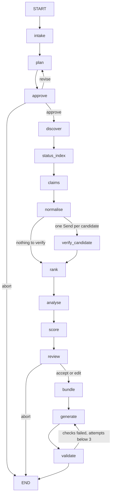

# Architecture

patentic is a fixed LangGraph workflow. Every run walks the same nodes in the same order; the model never chooses the next step. That keeps runs reproducible, makes every status claim traceable to code, and lets a stopped run resume from a checkpoint. ADR 002 explains the choice.

## Graph

The graph is built in `src/patentic/graph/build.py`; each node is a class in `src/patentic/graph/nodes/` that takes a `Deps` object (sources, model caller, config, today's date) at construction.

| Node | Does | Model? |
|---|---|---|
| `intake` | Validates the `ResearchRequest` | no |
| `plan` | Drafts the search plan (CPC codes, terms, exclusions, sources) | yes, `PlanDraft` schema, template fallback |
| `approve` | Gate 1: `interrupt()` with the plan; routes to `plan`, `discover` or the end | no |
| `discover` | BigQuery PatentsView search by CPC prefix over the grant window that covers all three fee stages | no |
| `status_index` | Fetches the Gazette weeks in the window and indexes expiry and reinstatement rows | no |
| `claims` | Claims, citations and continuity for patents that are both in the CPC set and listed as expired | no |
| `normalise` | Builds candidates, drops design and plant patents, runs the tier 1 (CPC) and tier 2 (claim terms) power screens | no |
| `verify_candidate` | One branch per candidate (`Send`): gathers status events and runs `assess_status` | no |
| `rank` | Orders eligible candidates and picks the analysis pool (8 by default) | no |
| `analyse` | Claim summary per pooled candidate, with a tier 3 powered or non-powered call | yes, quotes must appear word for word in the claims |
| `score` | Opportunity rationale per candidate; code computes the four scores and the total | yes, model scores are clamped to 1 to 5 |
| `review` | Gate 2: `interrupt()` with the scored list; keep, drop, flag, shortlist of at most two | no |
| `bundle` | Builds the `ReportBundle` and writes `bundle.json`; four short prose sections | yes, each with its own brief and a template fallback |
| `generate` | Renders `report.docx` and `deck.pptx` from the bundle | no |
| `validate` | Re-reads both files and compares them with the bundle; runs the OOXML schema check | no |

## State

`PipelineState` in `src/patentic/graph/state.py` is a `TypedDict`. Keys that several branches write use reducers:

- `records`, `claims`, `events`, `candidates`, `evidence`: dictionaries merged by key, so parallel `verify_candidate` branches never overwrite each other.
- `calls`: every model call's `CallMeta` (model, method, attempts, tokens, cost, last error), appended.
- `outages`: sources that failed in this run, appended once each.
- `plan`, `plan_feedback`, `revisions`, `approval`, `review`: the two gates and their history.
- `coverage`: which Gazette issues were read and which weeks are missing.
- `pool`, `bundle_path`, `report_path`, `deck_path`, `generation_attempts`, `validation`: later stages.

## Evidence and status

Every fact a source returns becomes an `EvidenceRecord` with a deterministic id, the source, the URL, the retrieval time and a short raw snippet. Status events (`lapse`, `reinstated`, `petition_granted` and so on) point at their evidence id.

`assess_status` in `src/patentic/domain/status_rules.py` turns the events into one of nine labels: `expired_nonpayment`, `reinstated`, `in_grace_period`, `petition_pending`, `expired_end_of_term`, `conflicting`, `in_force`, `not_subject_to_maintenance_fees`, `unknown`. The rules are ADR 004: the later official notice wins; a later secondary revival against an official lapse is `conflicting`; design and plant patents pay no fees.

Confidence (`very_low` to `very_high`) is computed by `compute_confidence` from the label, which sources agree, and whether the Gazette scan covers every week after the expiry date. A missing week or a scan that is more than a week old caps it at `medium`. The model never sets confidence.

## The bundle and the two files

`ReportBundle` (`src/patentic/report/bundle.py`) holds everything both files show: candidates with timelines, scores and recommendations, the flow counts, the prose, limitations and references. Its validators reject a shortlist that names an unknown candidate, real and synthetic candidates mixed outside demo mode, and a cited evidence id with no reference entry. The Word and PowerPoint renderers read only the bundle. `validate_outputs` then extracts the candidate table from each file and fails the run if identifiers, statuses, scores or recommendations differ from the bundle or from each other (ADR 005).

## Resume and logs

The graph is compiled with `SqliteSaver` on `outputs/runs/<id>/checkpoints.sqlite` and `durability="sync"`, so each finished node is on disk before the next starts. `patentic resume <id>` reloads `run.json` and continues from the last checkpoint, including a pending gate. Progress events go to the terminal through `get_stream_writer` and to `events.jsonl`, with keys, tokens and long snippets redacted.

## Replay

`scripts/build_replay.py` packs a finished run's HTTP and BigQuery caches into `fixtures/replay/cache.json.gz`, the model answers from its final checkpoint into `llm.json`, and the request, date and expected candidates into `provenance.json`. `patentic run --replay` unpacks them into a private cache, runs offline, and answers every model call from `llm.json` through `ReplayCaller`. `tests/e2e/test_replay.py` checks that the rerun matches.
